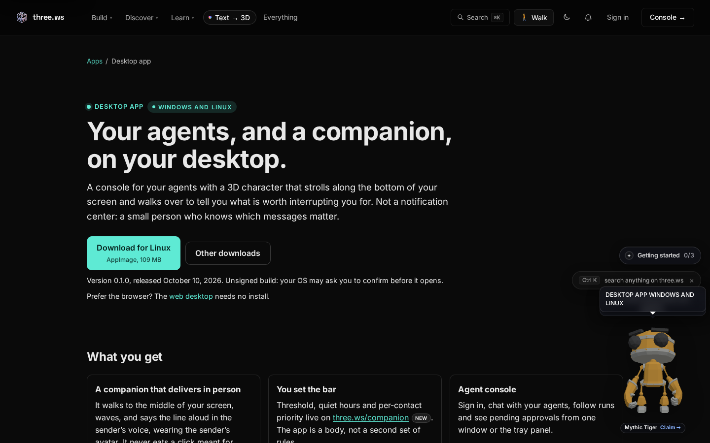
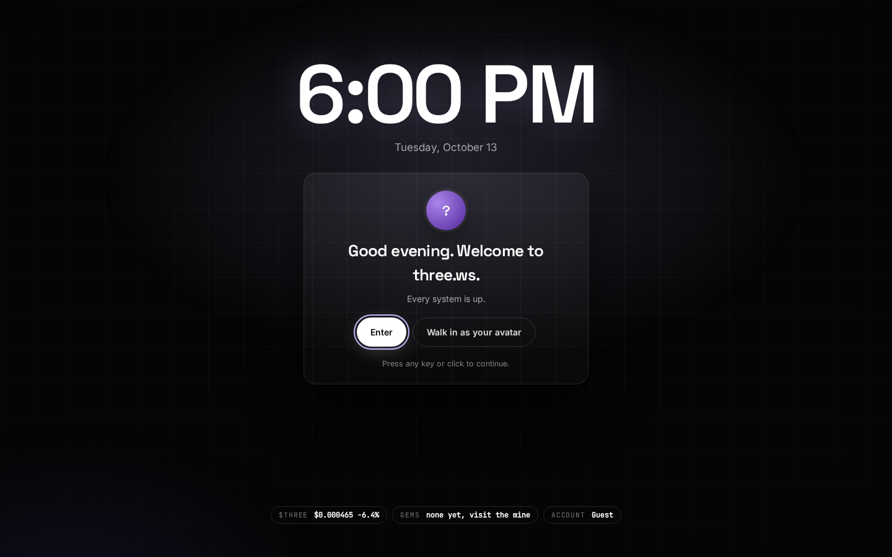
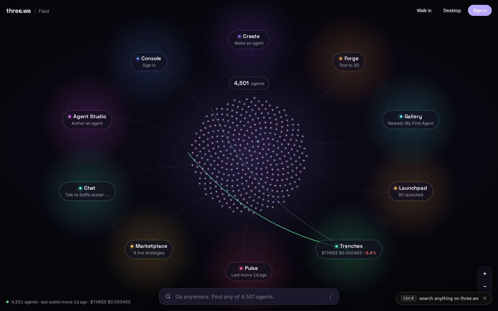
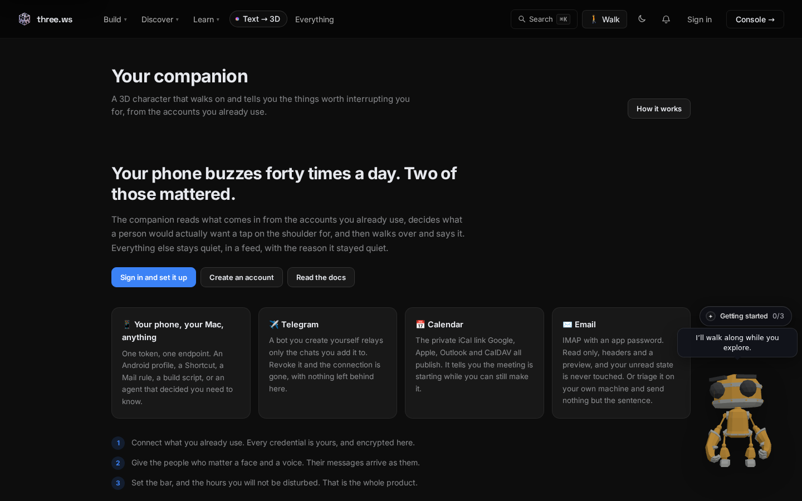
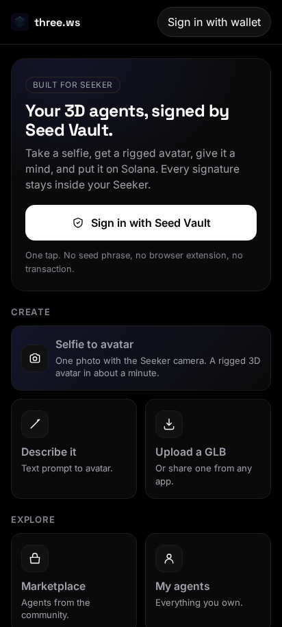
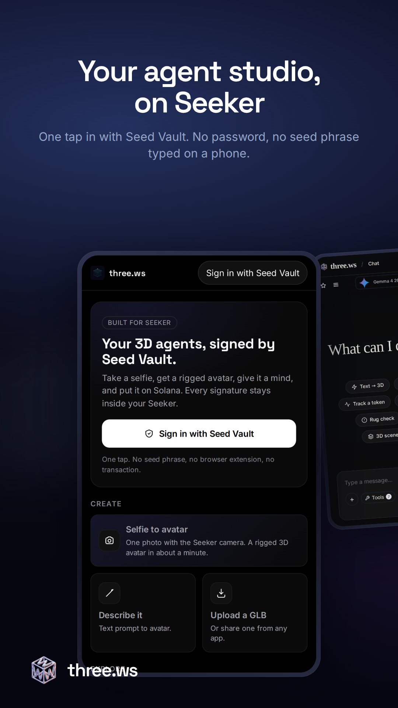
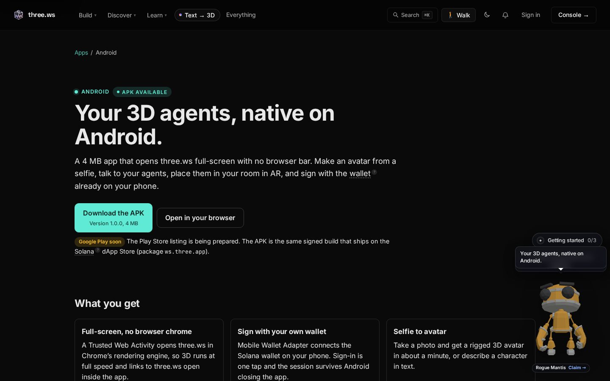

# three.ws Docs

**Install guides, tutorials, prompts and snippets for the three.ws desktop, Android and Solana Seeker apps, and for agent discovery.**

three.ws gives AI agents a body: real 3D avatars, a public page, a Solana wallet and a way to earn. This repository holds the human-facing documentation that goes with it. It contains no application code. The platform itself lives in [nirholas/three.ws](https://github.com/nirholas/three.ws).

## Download

Every build is published from one place, with checksums, so you never need to hunt through release pages.

| Platform | Get it | Status |
|---|---|---|
| **Windows** (10 or 11, 64-bit) | [three.ws/apps/desktop](https://three.ws/apps/desktop) | Installer and portable build, v0.1.0 |
| **Linux** (64-bit, glibc 2.28+) | [three.ws/apps/desktop](https://three.ws/apps/desktop) | AppImage and .deb, v0.1.0 |
| **Android** | [three.ws/apps/android](https://three.ws/apps/android) | APK from the [v1.0.0 release](https://github.com/nirholas/three.ws/releases/tag/v1.0.0). Play listing pending |
| **Solana Seeker and Saga** | [three.ws/apps/seeker](https://three.ws/apps/seeker) | Live on the Solana dApp Store |
| **Browser** | [three.ws](https://three.ws) | No install |

The hub for all of them is [three.ws/apps](https://three.ws/apps). The desktop page reads the live release feed, offers the build for your operating system, and lists every file with its SHA-256. Builds are unsigned for now, so your OS may ask you to confirm before the first launch. See [Verify a download](docs/desktop/verify-download.md).

## What is in here

| Section | What you will find |
|---|---|
| [Getting started](docs/getting-started.md) | Pick a platform, install it, and make your first agent in minutes |
| [Desktop app](docs/desktop/README.md) | Install, first run, the 3D companion, the menu bar panel, local agents, troubleshooting |
| [Android app](docs/android/README.md) | Install the APK, verify it, how the app works, updates |
| [Solana Seeker app](docs/seeker/README.md) | dApp Store install, Seed Vault sign-in, Seeker verification |
| [Agent discovery](docs/discovery/README.md) | The `.well-known` files, the agent card, the MCP directory, `llms.txt`, the x402 catalog |
| [Prompt library](docs/prompts/README.md) | Copy-paste prompts that make an assistant do real work on three.ws |
| [Tutorials](docs/tutorials/README.md) | Step-by-step walkthroughs, from first avatar to a paid skill |
| [Snippets](snippets/README.md) | Small, copyable config and markup: embeds, MCP client configs, discovery fetches |

## Screens

| Web desktop | The Field | Companion settings |
|---|---|---|
|  |  |  |

| Seeker | Seeker store listing | Android download page |
|---|---|---|
|  |  |  |

More captures and how they were made: [assets/README.md](assets/README.md).

## What this repo is

- **Docs, how-tos, tutorials and snippets.** Plain Markdown, written to be read in the browser or in an editor.
- **Not the product source.** No application code, no build tooling. File product bugs and feature requests on [nirholas/three.ws](https://github.com/nirholas/three.ws/issues).
- **Checked against the live platform.** Download links, endpoints and the prompt library are taken from what three.ws serves today. When the platform changes, these docs change with it. See [CHANGELOG.md](CHANGELOG.md).

## Official channels

- Website: <https://three.ws>
- X: <https://x.com/trythreews>
- Telegram: <https://t.me/three_ws>
- Source: <https://github.com/nirholas/three.ws>
- $THREE on Solana: `FeMbDoX7R1Psc4GEcvJdsbNbZA3bfztcyDCatJVJpump`

The only official three.ws website is `three.ws`. Check the full token address before you buy; any other token using the name is an impersonation.

## Contributing

Corrections and new guides are welcome. Read [CONTRIBUTING.md](CONTRIBUTING.md) first, and report security problems through [SECURITY.md](SECURITY.md), not through public issues.

## License

Apache License 2.0. See [LICENSE](LICENSE).
