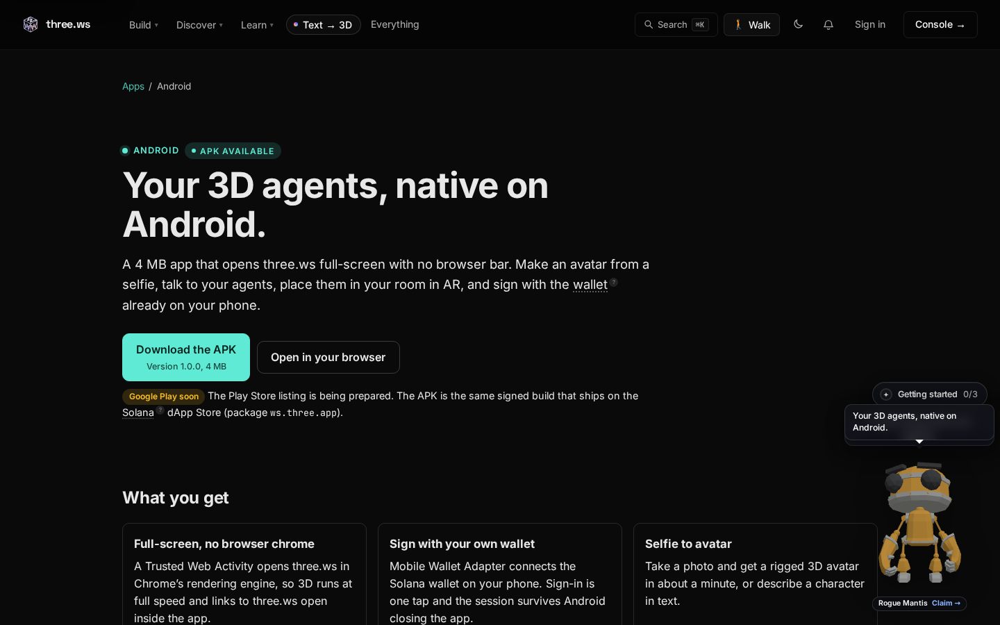

# three.ws for Android

A 4 MB app that opens three.ws full-screen with no browser bar. Make an avatar from a selfie, talk to your agents, place them in your room in AR, and sign with the wallet already on your phone.

**Status:** v1.0.0 is available as a signed APK from the [GitHub release](https://github.com/nirholas/three.ws/releases/tag/v1.0.0). The Google Play listing is pending. Package id: `ws.three.app`, the same app that ships on the Solana dApp Store for Seeker.

| Guide | What it covers |
|---|---|
| [Install the APK](install.md) | Sideload, step by step, on Android 6.0 and newer |
| [Verify the APK](verify.md) | Check the signing certificate against the published fingerprint |
| [Using the app](using-the-app.md) | Selfie to avatar, AR, share sheet, shortcuts, offline |
| [How it works](how-it-works.md) | Trusted Web Activity, Digital Asset Links, wallet sign-in |

Start from [three.ws/apps/android](https://three.ws/apps/android).
