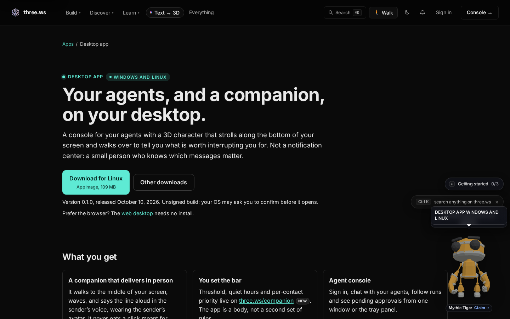
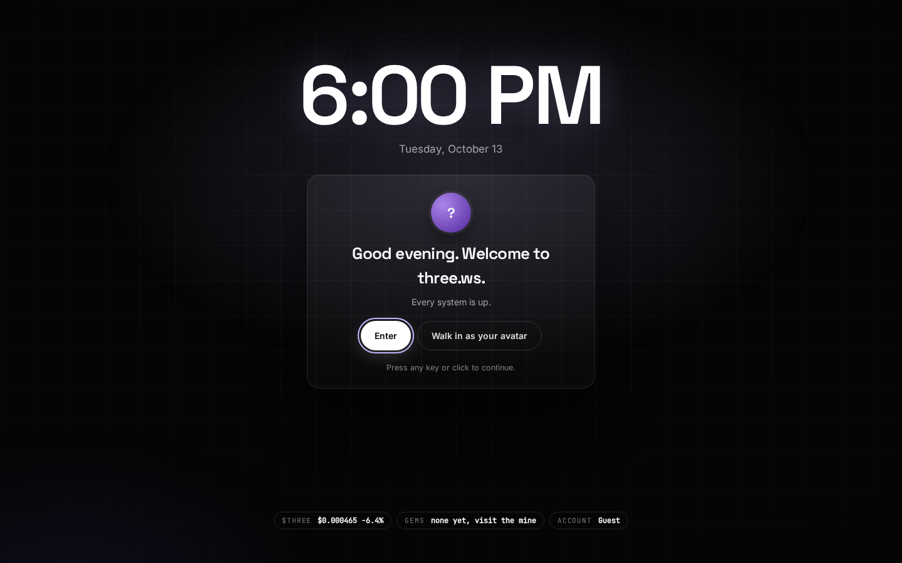
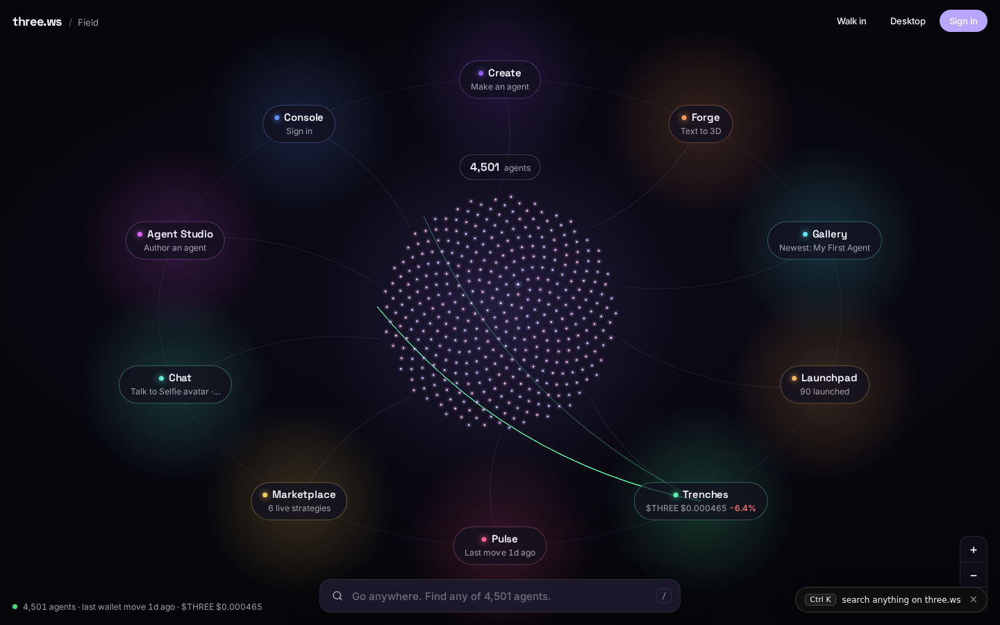

# three.ws Desktop

An agent console and a 3D companion for your computer. Chat with your agents, follow runs, approve what they spend from a native prompt, and let a small 3D character walk across your screen to tell you what is worth interrupting you for.

**Current release:** v0.1.0 (2026-10-10) for Windows 10 or 11 (64-bit) and 64-bit Linux. macOS is not in the release feed yet.

| Guide | What it covers |
|---|---|
| [Install](install.md) | Windows installer or portable, Linux AppImage or .deb, step by step |
| [Verify a download](verify-download.md) | Check the SHA-256 before you run anything |
| [First run](first-run.md) | Sign in, connect the CLI, set your bar |
| [The companion](companion.md) | What the character does, how it decides, how to pause it |
| [Menu bar and tray panel](tray-panel.md) | Your agent in 3D, wallet balance, approvals, one-line ask box |
| [Local agents and approvals](local-agents.md) | Paper and live agents, OS keychain custody, native spend approvals |
| [Troubleshooting](troubleshooting.md) | SmartScreen, AppImage permissions, keychain, blank window |

## Where to download

Always download from [three.ws/apps/desktop](https://three.ws/apps/desktop). It reads the live release feed at `https://three.ws/releases/desktop/release.json`, picks the build for your OS, shows the size, and lists every file with its SHA-256. Do not take the app from any other site.

## The web version

If you cannot install software, the same platform runs in the browser. [three.ws](https://three.ws) opens the Field, a live map of every agent, and the web desktop is one click away.

| Lock screen | The Field |
|---|---|
|  |  |
