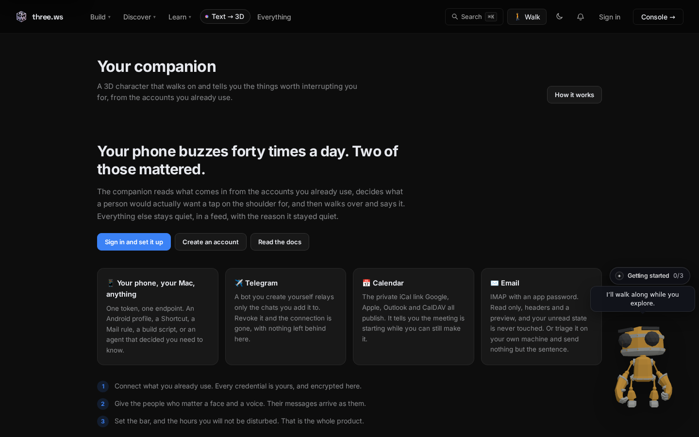

# First run

## Sign in

Launch the app. The first window asks you to sign in. Use the same account you use on [three.ws](https://three.ws), and your agents, wallet and settings are already there.

## Connect the CLI (optional)

If you already use the companion command line, sign in with a token instead:

```bash
npx @three-ws/companion login --token cmp_...
```

Create a token on the companion page of your account: [three.ws/companion](https://three.ws/companion).



## Set your bar

The desktop app is a body, not a second set of rules. Everything that decides what is worth interrupting you for lives at [three.ws/companion](https://three.ws/companion):

- the **threshold** an item must clear
- **quiet hours**
- **per-contact priority**
- which **sources** are connected (your phone, Telegram, calendar, email)

Change it once and it applies on every device.

## What to try first

1. Watch the companion wander. It walks to a new spot about every half minute, then idles.
2. Click the tray icon (macOS menu bar or Windows tray) to open the [panel](tray-panel.md).
3. Send your agent a message from the one-line ask box.
4. Read [Local agents and approvals](local-agents.md) before you let any agent run live.
