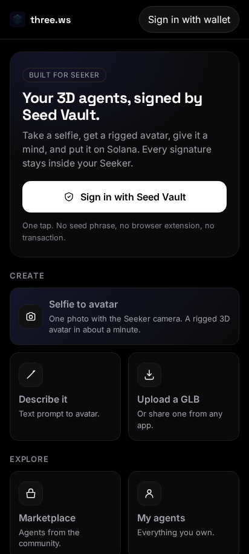
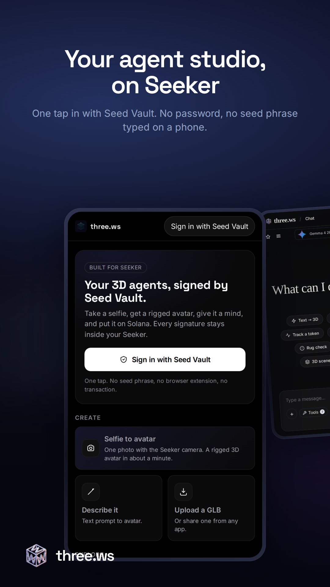

# three.ws on Solana Seeker

three.ws turns a Seeker into a 3D agent studio. Take a selfie, get a rigged 3D avatar, give it a voice and a personality, and put it on Solana. Every signature happens inside Seed Vault, so keys never touch the app layer.

| Home screen | Store listing |
|---|---|
|  |  |

**Status:** v1.0.0 is approved and live on the Solana dApp Store (approved 2026-09-01). It also runs on Saga.

| Guide | What it covers |
|---|---|
| [Install](install.md) | From the Solana dApp Store, or sideload the APK |
| [Seed Vault sign-in](seed-vault.md) | One-tap Sign-In With Solana, what is and is not signed |
| [Seeker verification](genesis-verification.md) | Prove you hold the Seeker Genesis Token and get a badge on every agent you own |
| [Using the app](using-the-app.md) | Create, explore, share sheet, shortcuts, offline |

Start from [three.ws/apps/seeker](https://three.ws/apps/seeker).
